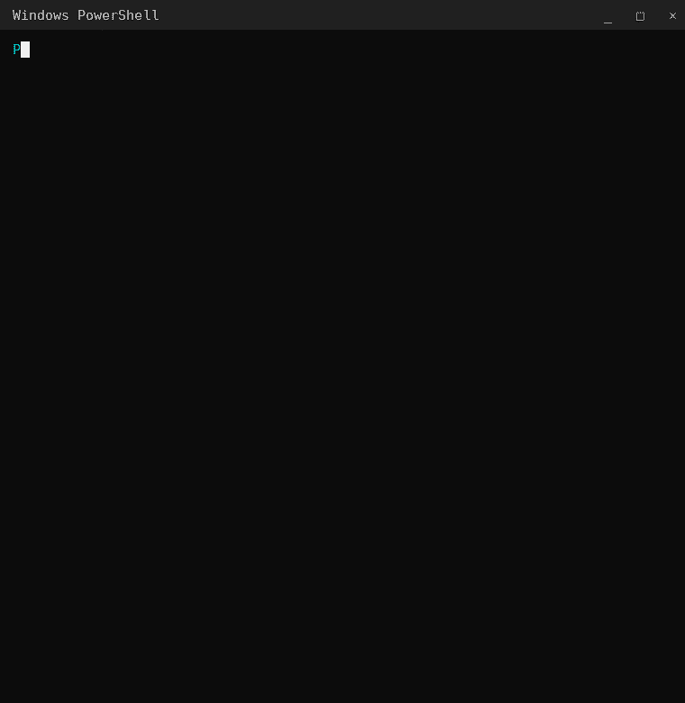
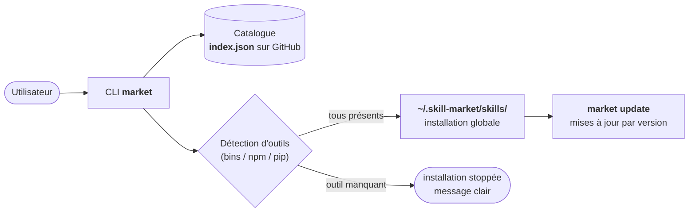
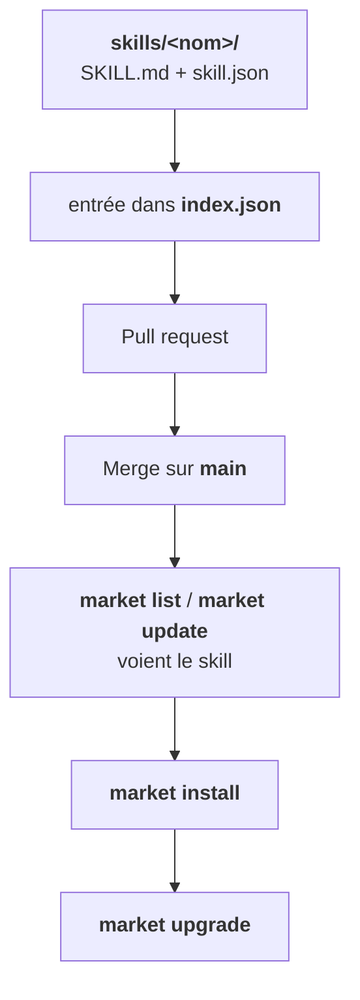

# skill-market

Marketplace de skills pour agents IA. Un catalogue hébergé sur GitHub, un CLI qui installe en global, détecte les outils présents sur la machine et gère les mises à jour.

[](LICENSE)
[](#catalogue)
[](#installer-le-cli)



## Intégrer dans ton IA

| Client | Commande ou geste |
|---|---|
| **Claude Code** (CLI, desktop, IDE) | `/plugin marketplace add BlackAngel242/skill-market` puis `/plugin install <nom>@blackangel242-skill-market` (ex. `fixit`). Le skill `claude-motion` s'installe sous le nom `motion-kit-whaleyxbt`, car Claude Code réserve le préfixe `claude-`. |
| **Claude Code, Codex, Cursor et autres agents compatibles Agent Skills** | `market install <nom> --tool claude` (ou `codex`, `cursor`, `gemini`, `agents`) : copie dans le dossier que le client lit, avec détection des outils requis. Ou `npx skills add BlackAngel242/skill-market --skill <nom> -g -y`. |
| **Codex (plugin)** | `codex plugin marketplace add BlackAngel242/skill-market` : plugin `drsmoke-quality` (Fixit + PRD Table Ronde). |
| **Claude desktop / claude.ai** | Télécharger `<nom>.zip` dans la [dernière release](https://github.com/BlackAngel242/skill-market/releases/latest), puis Customize > Skills > + > Create skill > Upload a skill (exécution de code activée). Chemin documenté par Anthropic ; l'import de ces archives n'a pas encore été essayé sur un compte. `claude-motion` est fourni sous `motion-kit-whaleyxbt.zip` (le mot « claude » est réservé dans les noms de skill). |
| **ChatGPT** | Même archive, ou `Fixit-ChatGPT.zip`, `TableRonde-ChatGPT.zip`, `AfficheUX-ChatGPT.zip` de la release, à importer dans un compte compatible. |
| **N'importe quelle IA avec accès aux fichiers** | Lui donner l'URL du dépôt : chaque skill est un dossier `skills/<nom>/` (`SKILL.md` avec frontmatter `name`/`description`) à copier dans son dossier de skills. `AGENTS.md` lui dit quoi lire d'abord. |

Sans `--tool`, `market install` range le skill dans `~/.skill-market/skills/`, qu'aucun client ne lit : utile pour garder une copie, pas pour l'utiliser. Une ancienne installation dans `~/.codex/skills` n'est plus lue par Codex, qui lit `~/.agents/skills` : réinstalle avec `--tool codex`. Google Antigravity (`agy`) et Gemini CLI lisent `~/.gemini/skills` : utilise `--tool gemini` (constaté le 04/11 : Antigravity ne lit ni `~/.agents/skills` ni `~/.claude/skills`).

## Comment ça marche



## Installer Fixit et PRD Table Ronde sur GPT / Codex

Les deux compétences sont déjà dans le dépôt. Un assistant Windows, un installateur local sans réseau et des archives d'import pour ChatGPT sont documentés dans **[Installation GPT et Codex](docs/INSTALLATION-GPT.md)**.

- Windows : double-cliquer sur `Installer Skill Market.bat` depuis le dépôt complet.
- Codex : `node scripts/install-skills.mjs --tool codex`.
- ChatGPT : générer `Fixit-ChatGPT.zip` et `TableRonde-ChatGPT.zip` avec `python scripts/build-chatgpt.py`, puis importer les skills dans un compte éligible.
- Plugin local : `codex plugin marketplace add BlackAngel242/skill-market`.

Les skills originaux et leurs références restent la source de vérité ; les miroirs du plugin sont contrôlés par la CI.

### Fixit 2.1 modulaire

Le skill Fixit est maintenant un **orchestrateur** : il choisit les modules pertinents selon le livrable, sans exécuter artificiellement tous les contrôles. Le noyau (`skills/fixit/SKILL.md`) charge toujours `references/verification-gate.md`, puis les modules `revue-visuelle.md`, `revue-technique.md`, `revue-contenu.md` et/ou `revue-equipe.md` selon le risque. Le suivi des leçons est dans `references/memoire-apprentissage.md`. Le guide visuel historique est préservé. Le module optionnel `references/critique-ux.md` complète désormais l'analyse des interfaces et parcours (première impression, navigation, hiérarchie, états, accessibilité et vérité métier), inspiré du skill [design-critique d'Anthropic](https://github.com/anthropics/knowledge-work-plugins/tree/main/design/skills/design-critique). Il ne remplace ni le contrôle du rendu ni les tests Android.

Pour une installation locale déjà présente, **ne pas écraser silencieusement** : utiliser `--replace` après examen des différences ; l'ancienne copie est sauvegardée. Le CLI `market upgrade fixit` reste disponible pour ses installations suivies par le gestionnaire de versions.

## Installer le CLI

```bash
mkdir -p ~/.local/bin
curl -fsSL https://raw.githubusercontent.com/BlackAngel242/skill-market/main/cli/market -o ~/.local/bin/market
chmod +x ~/.local/bin/market
```

Prérequis : `curl`, Python 3 (`python3` ou `python`), `git` (recommandé). `~/.local/bin` doit être dans ton `PATH`.

Sous Git Bash (Windows), `python3` mène souvent à l'alias du Microsoft Store, qui ne lance rien : le CLI se rabat alors sur `python`.

## Installer le CLI (Windows)

Le CLI existe aussi en PowerShell natif (`cli/market.ps1`), sans WSL ni Git Bash :

```powershell
Invoke-WebRequest https://raw.githubusercontent.com/BlackAngel242/skill-market/main/cli/market.ps1 -OutFile market.ps1
powershell -ExecutionPolicy Bypass -File .\market.ps1 install uxfix
```

Fonctionne avec Windows PowerShell 5.1 (`powershell`, présent sur tout Windows 10/11) et PowerShell 7 (`pwsh`) ; la CI teste les deux. Toutes les commandes sont identiques : `list`, `search`, `info`, `install`, `upgrade`, `update`, `remove`, `installed`, `doctor`, `publish`.

## Alternative : installer via `npx skills add`

Pas besoin du CLI `market` : le dépôt est compatible avec le gestionnaire de skills de Vercel Labs.

```bash
npx skills add BlackAngel242/skill-market --list          # voir les skills dispo
npx skills add BlackAngel242/skill-market --skill uxfix -g -y   # installer un skill (global)
npx skills add BlackAngel242/skill-market --all -g -y            # tout installer
```

Note : via `npx skills add`, seuls les fichiers du skill sont copiés. La détection et l'installation automatique des outils requis (`skill.json` → `requires`) reste l'exclusivité de `market install`.

## Quel parcours d'installation choisir

| Parcours | Destination | Pour quoi |
|---|---|---|
| `market install <nom>` | `~/.skill-market/skills/<nom>` (`MARKET_HOME`) | catalogue complet, détection des outils requis, mises à jour par version |
| `npx skills add ...` | dossier de skills du client choisi | copie simple, sans contrôle des prérequis |
| `node scripts/install-skills.mjs --tool <client>` | `.agents/skills` (Codex), `.claude/skills` ou `.cursor/skills` | Fixit et PRD Table Ronde seulement, sans réseau, `--replace` avec sauvegarde |
| `python scripts/build-chatgpt.py` | `dist/*.zip` | import manuel dans un compte ChatGPT compatible |

Un skill copié sur le disque n'est pas forcément découvert par ton client : vérifie qu'il apparaît dans la liste des skills du client.

## Utilisation

```bash
market list              # catalogue distant
market search design     # recherche
market info uxfix        # fiche détaillée
market install uxfix             # installe en global, détecte/installe les outils requis
market install uxfix -y          # sans demander confirmation
market install uxfix --force     # remplace un dossier non suivi par market (ancienne copie sauvegardée)
market upgrade uxfix             # met à jour un skill
market update                    # met à jour tout ce qui est installé
market installed                 # ce qui est installé localement
market doctor                    # diagnostic en lecture seule : versions, outils requis
market remove uxfix              # désinstalle
market publish skills/<nom>    # valide un skill avant soumission (PR)
```

Les skills s'installent dans `~/.skill-market/skills/<nom>` (variable `MARKET_HOME` pour changer). Avant tout remplacement (`upgrade`, `update`, `--force`), l'ancienne copie est déplacée dans `~/.skill-market/backup/<nom>-<version>-<horodatage>-<identifiant>/`, puis restaurée si la nouvelle copie échoue. Un dossier qui n'a pas été installé par `market` n'est jamais écrasé sans `--force`. Les sauvegardes ne sont pas purgées automatiquement : supprime-les à la main quand tu n'en as plus besoin. Si une installation est interrompue (fenêtre fermée, coupure), la copie précédente reste dans `backup/` : la remettre dans `skills/<nom>`.

Codes de sortie : `0` succès ; non nul si un prérequis manque ou est refusé, si un téléchargement ou une installation npm/pip échoue, ou si `update` a au moins un échec. `market doctor` renvoie `0` (rien à signaler), `1` (anomalie) ou `2` (diagnostic incomplet, catalogue inaccessible).

## Détection d'outils

Chaque skill déclare ses prérequis dans `skill.json` :

```json
{
  "name": "uxfix",
  "version": "1.0.0",
  "requires": {
    "bins": ["node"],
    "npm": ["impeccable"],
    "pip": []
  }
}
```

À l'installation, le CLI vérifie chaque entrée :

| Clé | Comportement |
|---|---|
| `bins` | le binaire doit exister sur la machine, sinon l'installation s'arrête avec un message clair |
| `npm` / `pip` | si le paquet manque, le CLI propose de l'installer (avec `-y`, il le fait sans demander) |

## AfficheUX — direction artistique par références

AfficheUX est un **skill maître** qui orchestre un essaim de rôles : brief, piste initiale, recherche Pinterest traçable, analyse UX, propositions, validation, création, contrôle Fixit et capitalisation des retours. Il fonctionne en mode multi-agents quand le client le permet, ou séquentiellement sans prétendre déployer des sous-agents. Pinterest et les métriques d'engagement ne sont utilisés que si accessibles et vérifiables.

- Installer : `market install afficheux`, ou `npx skills add BlackAngel242/skill-market --skill afficheux -g -y`.
- Voir le protocole de validation : [AfficheUX et critères d'adoption](docs/AFFICHEUX-VALIDATION.md).
- L'archive `AfficheUX-ChatGPT.zip` peut être créée par `python scripts/build-chatgpt.py` pour un import manuel dans un compte compatible.
- La mémoire explicite d'apprentissage reste dans un dossier de projet autorisé, jamais prétendument synchronisée en silence.

## herdr-team — une équipe d'IA qui apprend ensemble

Pour qui lance plusieurs agents (Codex, Claude, opencode, agy, omp...) dans [Herdr](https://herdr.dev) : `herdr-team` les fait travailler en parallèle par fichiers (`herdr-ask`, fin de réponse prouvée par une sentinelle, une tâche par agent), organise un brainstorm en tours (propositions, critique croisée, décision soumise à l'utilisateur) et fait progresser l'équipe : chaque réponse rapporte erreurs, astuces et méthodes, chaque correction est expliquée (quoi, pourquoi, comment, comment l'éviter), et une mémoire commune `LECONS.md` est lue avant chaque mission, d'un projet à l'autre.

- Installer : `market install herdr-team`, puis copier `scripts/herdr-ask` et les fichiers de `references/` comme indiqué dans le `SKILL.md`.
- Prérequis : `herdr`, `bash` (Git Bash sous Windows).

## Catalogue

| Skill | Version | Description |
|---|---|---|
| `afficheux` |  | Essaim de direction artistique par références Pinterest : UX, Fixit et mémoire vérifiable. |
| `uxfix` |  | Corrige seul les défauts UI : boucle détecter → corriger → revérifier jusqu'à 99/100 (contrastes, halos, easings, palettes, copy). |
| `prd-table-ronde` |  | Transforme une idée en PRD cadrée via une table ronde d'experts dimensionnée. |
| `smokekit-ai-workflow-orchestration` |  | Orchestration multi-IA auto-évolutive : 20 agents SDLC, router réel avec détection d'outils, boucle d'apprentissage qui ajuste le routing selon tes corrections. |
| `fixit` |  | Contrôle qualité adaptatif : modules visuel, technique, contenu et équipe ; preuves, corrections autorisées, réinspection et apprentissage. |
| `wassup` |  | État des lieux d'un dépôt : compare docs, plans, issues et code réel, signale les désynchronisations et propose les 3 prochaines actions. Mode portefeuille, sortie JSON, contrôles pilotage. |
| `collect` |  | Trouve les problèmes d'un projet depuis plusieurs sources et les classe en tickets vérifiés, sans rien modifier. Dry-run par défaut. |
| `secretscan` |  | Détecte les secrets committés : fichiers .env, clés API et tokens en dur dans le code, clés privées. Signale sans jamais afficher les valeurs. |
| `merge-gate` |  | Checklist avant fusion : base à jour, vérifications au vert, commit relu épinglé, pas de force push. Verdict GO / NO-GO motivé. |
| `motion-launch` |  | Prépare une vidéo de lancement produit : script, accroches, plan caméra, étalonnage. Version typographique sans voix off par défaut. |
| `motion-graphics` |  | Graphiques animés : titres, lower thirds, transitions, infographies animées. Familles d'effets et règles de lisibilité. |
| `rush-cut` |  | Montage de rushs : plan de coupes (blancs, ratés), animations à ajouter, sous-titres avec timecodes et SRT. |
| `motion-illustrate` |  | Plans d'illustration calés sur la narration, détourage des sujets, storyboard visuel phrase par phrase. |
| `explainer-storyboard` |  | Vidéos explicatives : 7 styles, storyboard toujours produit AVANT toute animation. |
| `motion-sound` |  | Sound design : choix musical, effets sonores, mixage, timing calé sur la musique. |
| `motion-web` |  | Anime une interface web depuis une phrase : boutons, cartes, transitions. Code CSS/JS propre et performant. |
| `motion-principles` |  | Les 12 principes d'animation Disney traduits en règles pratiques pour des animations qui ont l'air humaines. |
| `product-launch-motion` |  | Vidéos de lancement cinématiques générées en code (par AbubakrChan, MIT) : caméra, étalonnage, son calé sur le rythme. |
| `motion-graphics-skills` |  | Bundle de 15 skills de motion graphics (par charlie947, MIT) : vidéos de lancement générées en code, sans After Effects. |
| `claude-motion` |  | Toolkit motion design (par whaleyxbt, MIT) : 4 skills — design, sound design, review-loop, web-sims. |
| `motion-design` |  | Principes universels de motion design pour agents (par LottieFiles, MIT) : timing, easing, 12 principes Disney pour UI. |
| `animate` |  | Animation procédurale en code (par cth9191, MIT) : storyboard d'abord, styles prédéfinis, synchro musicale. |
| `remotion-motion-graphics` |  | Motion graphics avec Remotion (par haidrrrry, MIT) : sous-titres, B-roll et son depuis un seul prompt. |
| `explainroo` |  | Vidéos explicatives et démos produit narrées (par vincentsch, MIT) : voix locale Kokoro dont le français, timing Whisper, dessins canvas calés sur la narration, MP4 + sous-titres. Aucune clé API. |
| `herdr-team` |  | Équipe d'agents IA dans Herdr : brainstorm en plusieurs tours, critique croisée, décision, travail parallèle par fichiers, et apprentissage en essaim (chaque correction expliquée, mémoire commune entre projets). |

### Skills vidéo et motion : lequel choisir

| Besoin | Skill |
|---|---|
| Vidéo de lancement produit : script, accroches, plan caméra | `motion-launch` ; version cinématique en code : `product-launch-motion` |
| Vidéo explicative : choisir un style et storyboarder avant d'animer | `explainer-storyboard` |
| Vidéo explicative ou démo narrée, voix locale, MP4 + sous-titres | `explainroo` |
| Animation procédurale en code (canvas, musique synthétisée) | `animate` |
| Projet Remotion (React) | `remotion-motion-graphics` |
| Titres, lower thirds, infographies animées | `motion-graphics` |
| Animer une interface web (boutons, cartes, transitions) | `motion-web` |
| Principes d'animation (Disney) appliqués à l'UI | `motion-principles` ; version LottieFiles : `motion-design` |
| Musique, bruitages, mixage | `motion-sound` |
| Montage de rushs, coupes, SRT | `rush-cut` |
| Illustrations calées sur la narration | `motion-illustrate` |

Les bundles `motion-graphics-skills` (15 skills) et `claude-motion` (4 skills) s'installent en un seul dossier : leurs sous-skills sont dans `skills/<bundle>/<sous-skill>/SKILL.md`. `market install motion-design` installe le skill LottieFiles, pas le sous-skill `claude-motion/motion-design`.

## Publier un skill



1. Crée `skills/<nom>/` avec au minimum `SKILL.md` (la doc du skill) et `skill.json` (nom, version, description, `requires`).
2. Valide avec `market publish skills/<nom>` : 12 vérifications (frontmatter, JSON, cohérence des noms, version semver, collision dans `index.json`, secrets, taille). La commande affiche l'entrée `index.json` à ajouter si tout passe.
3. Ajoute cette entrée dans `index.json`, puis régénère le marketplace Claude Code : `python scripts/build-distributions.py` (la CI échoue si `.claude-plugin/marketplace.json` n'est pas à jour). Ajoute aussi la ligne du catalogue et le badge du README.
4. Ouvre une pull request. Une fois mergée, `market list` et `market update` voient le skill.

Voir [CONTRIBUTING.md](CONTRIBUTING.md) pour le détail.

## Licence

MIT. Voir [LICENSE](LICENSE).
