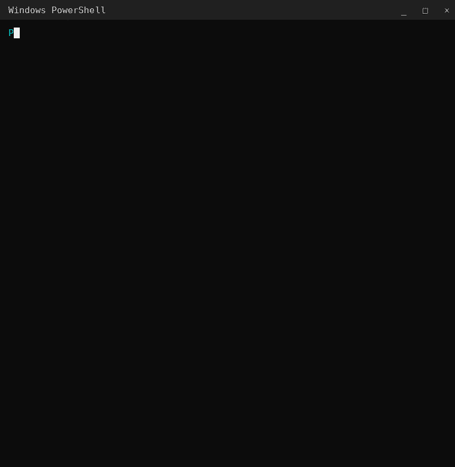
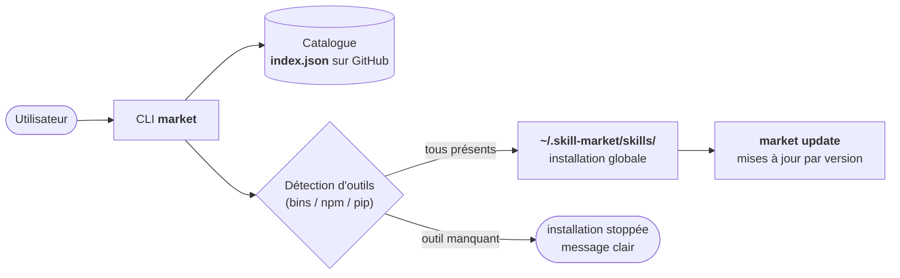
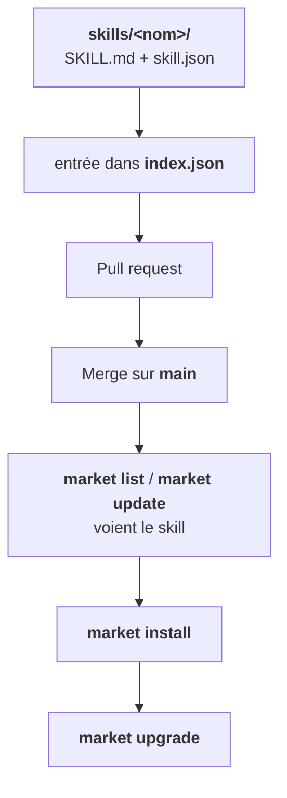

# skill-market

Marketplace de skills pour agents IA. Un catalogue hébergé sur GitHub, un CLI qui installe en global, détecte les outils présents sur la machine et gère les mises à jour.

[](LICENSE)
[](#catalogue)
[](#installer-le-cli)



## Comment ça marche



## Installer Fixit et PRD Table Ronde sur GPT / Codex

Les deux compétences sont déjà dans le dépôt. Un assistant Windows, un installateur local sans réseau et des archives d'import pour ChatGPT sont documentés dans **[Installation GPT et Codex](docs/INSTALLATION-GPT.md)**.

- Windows : double-cliquer sur `Installer Skill Market.bat` depuis le dépôt complet.
- Codex : `node scripts/install-skills.mjs --tool codex`.
- ChatGPT : générer `Fixit-ChatGPT.zip` et `TableRonde-ChatGPT.zip` avec `python scripts/build-chatgpt.py`, puis importer les skills dans un compte éligible.
- Plugin local : `codex plugin marketplace add BlackAngel242/skill-market`.

Les skills originaux et leurs références restent la source de vérité ; les miroirs du plugin sont contrôlés par la CI.

## Installer le CLI

```bash
curl -sSL https://raw.githubusercontent.com/BlackAngel242/skill-market/main/cli/market -o ~/.local/bin/market
chmod +x ~/.local/bin/market
```

Prérequis : `curl`, `python3`, `git` (recommandé). `~/.local/bin` doit être dans ton `PATH`.

## Installer le CLI (Windows)

Le CLI existe aussi en PowerShell natif (`cli/market.ps1`), sans WSL ni Git Bash :

```powershell
Invoke-WebRequest https://raw.githubusercontent.com/BlackAngel242/skill-market/main/cli/market.ps1 -OutFile market.ps1
powershell -ExecutionPolicy Bypass -File .\market.ps1 install uxfix
```

Toutes les commandes sont identiques : `list`, `search`, `info`, `install`, `upgrade`, `update`, `remove`, `installed`, `publish`.

## Alternative : installer via `npx skills add`

Pas besoin du CLI `market` : le dépôt est compatible avec le gestionnaire de skills de Vercel Labs.

```bash
npx skills add BlackAngel242/skill-market --list          # voir les skills dispo
npx skills add BlackAngel242/skill-market --skill uxfix -g -y   # installer un skill (global)
npx skills add BlackAngel242/skill-market --all -g -y            # tout installer
```

Note : via `npx skills add`, seuls les fichiers du skill sont copiés. La détection et l'installation automatique des outils requis (`skill.json` → `requires`) reste l'exclusivité de `market install`.

## Utilisation

```bash
market list              # catalogue distant
market search design     # recherche
market info uxfix        # fiche détaillée
market install uxfix             # installe en global, détecte/installe les outils requis
market install uxfix -y          # sans demander confirmation
market upgrade uxfix             # met à jour un skill
market update                    # met à jour tout ce qui est installé
market installed                 # ce qui est installé localement
market remove uxfix              # désinstalle
market publish skills/<nom>    # valide un skill avant soumission (PR)
```

Les skills s'installent dans `~/.skill-market/skills/<nom>` (variable `MARKET_HOME` pour changer).

## Détection d'outils

Chaque skill déclare ses prérequis dans `skill.json` :

```json
{
  "name": "uxfix",
  "version": "1.0.0",
  "requires": {
    "bins": ["node"],
    "npm": ["impeccable"],
    "pip": []
  }
}
```

À l'installation, le CLI vérifie chaque entrée :

| Clé | Comportement |
|---|---|
| `bins` | le binaire doit exister sur la machine, sinon l'installation s'arrête avec un message clair |
| `npm` / `pip` | si le paquet manque, le CLI propose de l'installer (avec `-y`, il le fait sans demander) |

## Catalogue

| Skill | Version | Description |
|---|---|---|
| `uxfix` |  | Corrige seul les défauts UI : boucle détecter → corriger → revérifier jusqu'à 99/100 (contrastes, halos, easings, palettes, copy). |
| `prd-table-ronde` |  | Transforme une idée en PRD cadrée via une table ronde d'experts dimensionnée. |
| `smokekit-ai-workflow-orchestration` |  | Orchestration multi-IA auto-évolutive : 20 agents SDLC, router réel avec détection d'outils, boucle d'apprentissage qui ajuste le routing selon tes corrections. |
| `fixit` |  | Revue visuelle des rendus : double lecture expert et utilisateur ordinaire, défauts classés BLOQUANT/IMPORTANT/OPTIONNEL, corrections précises, réinspection obligatoire, verdict REJETÉ/À CORRIGER/VALIDÉ SOUS RÉSERVE/VALIDÉ. |
| `wassup` |  | État des lieux d'un dépôt : compare docs, plans, issues et code réel, signale les désynchronisations et propose les 3 prochaines actions. Mode portefeuille, sortie JSON, contrôles pilotage. |
| `collect` |  | Trouve les problèmes d'un projet depuis plusieurs sources et les classe en tickets vérifiés, sans rien modifier. Dry-run par défaut. |
| `secretscan` |  | Détecte les secrets committés : fichiers .env, clés API et tokens en dur dans le code, clés privées. Signale sans jamais afficher les valeurs. |
| `merge-gate` |  | Checklist avant fusion : base à jour, vérifications au vert, commit relu épinglé, pas de force push. Verdict GO / NO-GO motivé. |
| `motion-launch` |  | Prépare une vidéo de lancement produit : script, accroches, plan caméra, étalonnage. Version typographique sans voix off par défaut. |
| `motion-graphics` |  | Graphiques animés : titres, lower thirds, transitions, infographies animées. Familles d'effets et règles de lisibilité. |
| `rush-cut` |  | Montage de rushs : plan de coupes (blancs, ratés), animations à ajouter, sous-titres avec timecodes et SRT. |
| `motion-illustrate` |  | Plans d'illustration calés sur la narration, détourage des sujets, storyboard visuel phrase par phrase. |
| `explainer-storyboard` |  | Vidéos explicatives : 7 styles, storyboard toujours produit AVANT toute animation. |
| `motion-sound` |  | Sound design : choix musical, effets sonores, mixage, timing calé sur la musique. |
| `motion-web` |  | Anime une interface web depuis une phrase : boutons, cartes, transitions. Code CSS/JS propre et performant. |
| `motion-principles` |  | Les 12 principes d'animation Disney traduits en règles pratiques pour des animations qui ont l'air humaines. |
| `product-launch-motion` |  | Vidéos de lancement cinématiques générées en code (par AbubakrChan, MIT) : caméra, étalonnage, son calé sur le rythme. |
| `motion-graphics-skills` |  | Bundle de 15 skills de motion graphics (par charlie947, MIT) : vidéos de lancement générées en code, sans After Effects. |
| `claude-motion` |  | Toolkit motion design (par whaleyxbt, MIT) : 4 skills — design, sound design, review-loop, web-sims. |
| `motion-design` |  | Principes universels de motion design pour agents (par LottieFiles, MIT) : timing, easing, 12 principes Disney pour UI. |
| `animate` |  | Animation procédurale en code (par cth9191, MIT) : storyboard d'abord, styles prédéfinis, synchro musicale. |
| `remotion-motion-graphics` |  | Motion graphics avec Remotion (par haidrrrry, MIT) : sous-titres, B-roll et son depuis un seul prompt. |
| `explainroo` |  | Vidéos explicatives et démos produit narrées (par vincentsch, MIT) : voix locale Kokoro dont le français, timing Whisper, dessins canvas calés sur la narration, MP4 + sous-titres. Aucune clé API. |

## Publier un skill



1. Crée `skills/<nom>/` avec au minimum `SKILL.md` (la doc du skill) et `skill.json` (nom, version, description, `requires`).
2. Valide avec `market publish skills/<nom>` : 12 vérifications (frontmatter, JSON, cohérence des noms, version semver, collision dans `index.json`, secrets, taille). La commande affiche l'entrée `index.json` à ajouter si tout passe.
3. Ajoute cette entrée dans `index.json`.
4. Ouvre une pull request. Une fois mergée, `market list` et `market update` voient le skill.

Voir [CONTRIBUTING.md](CONTRIBUTING.md) pour le détail.

## Licence

MIT. Voir [LICENSE](LICENSE).
